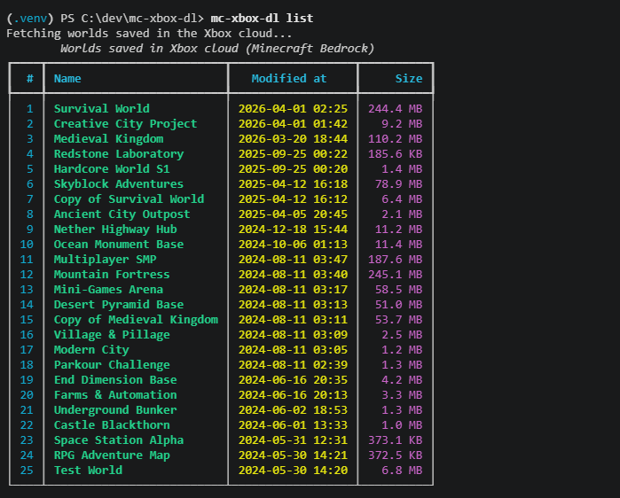
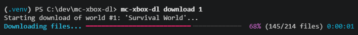

# mc-xbox-dl

[](https://github.com/vinifreitaspaulino/mc-xbox-dl/actions/workflows/ci.yml)
[](LICENSE)
[](https://www.python.org/downloads/)
[](#)

> **Read this in another language:** [Português Brasileiro](README.pt-br.md)

CLI tool to list, export, and download personal **Minecraft Bedrock (Xbox)** worlds saved in Xbox Live cloud storage as `.mcworld` packages or install them directly into your local PC game directory.

> **NOT AN OFFICIAL MINECRAFT PRODUCT. NOT APPROVED BY OR ASSOCIATED WITH MOJANG OR MICROSOFT.**  
> `mc-xbox-dl` is an independent, free, open-source utility created exclusively for personal backup and data portability under user-controlled credentials. It is not affiliated with, maintained by, or endorsed by Microsoft Corporation or Mojang Studios.




---

## Important Notice & Risk Disclaimer

- **Unofficial API & Client Emulation:** This tool communicates directly with undocumented Xbox Live Connected Storage and Title Storage endpoints (`titlestorage.xboxlive.com`). To authenticate, it uses the public `client_id` of **Minecraft Bedrock (Android)** (`0000000048183522`), signs Proof-of-Possession requests with an ephemeral ECDSA P-256 device key, and requests SISU/XSTS authorization tokens bound to the console `TitleId` (`1828326430`).
- **Contractual & Account Risks:** Accessing undocumented Xbox Live APIs using first-party client identifiers is not officially supported by Microsoft or Mojang. Potential risks include **endpoint changes or blocking by Microsoft**, temporary rate-limiting, or **enforcement actions (including suspension or termination of your Xbox Live / Microsoft account)** for violating the Microsoft Services Agreement. Use of this tool is strictly at your own responsibility and risk.
- **Read-Only & Rate-Limited Design:** To minimize risk, `mc-xbox-dl` operates in **strict read-only (`GET`)** mode, transfers only your own cloud-saved worlds, enforces inter-download pacing, and immediately aborts (`fail-fast`) upon encountering HTTP `401`, `403`, or `429`.
- **Explicit Consent Required:** Running `mc-xbox-dl login` requires explicit interactive risk acceptance, or the `--accept-risk` flag for automated scripts.
- **Local-First Privacy:** All credentials and tokens are stored locally on your machine (`%APPDATA%\mc-xbox-dl` on Windows or `~/.config/mc-xbox-dl` on Linux). No data is sent to third parties or external telemetry servers. See [SECURITY.md](SECURITY.md) for details.

---

## Key Features

- **100% Free & Open Source:** No subscription fees, no third-party servers, and no Minecraft Realms subscription required.
- **Device Code Authentication:** Log in securely via Microsoft's OAuth 2.0 Device Authorization flow (`https://www.microsoft.com/link`). Passwords are never entered or stored in the CLI.
- **Bilingual Interface (i18n):** Automatic operating system language detection (English / Portuguese) with manual override and persistent preference (`--lang en` / `--lang pt`).
- **Cloud World Listing with Caching:** Fast inspection of world names, modification dates, and sizes with 5-minute local caching (`--no-cache` to force a live refresh).
- **Single & Batch Downloads:** Download individual worlds by index, name, or ID, or batch export all cloud saves (`--all`) with automatic resume and rate-paced transfers.
- **Direct PC Installation (`--install`):** Automatically detects modern **GDK** (`%APPDATA%\Minecraft Bedrock\Users\<ID>\...`) and legacy **UWP** (`%LOCALAPPDATA%\Packages\Microsoft.MinecraftUWP_...\...`) installations on Windows, extracting worlds directly into `minecraftWorlds`.
- **Automatic Minecraft Java Edition Conversion (`--java`, `--install-java`):** Automatically downloads and runs the official [Chunker CLI](https://github.com/HiveGamesOSS/Chunker) (`HiveGamesOSS/Chunker`) to convert Xbox Bedrock worlds into Minecraft Java Edition worlds and optionally install them directly into `.minecraft/saves` on Windows and Linux.
- **Cross-Platform Support (Windows & Linux):** Native `.mcworld` export on both Windows and Linux, with helpful path guidance for Linux Bedrock launchers (`mcpelauncher`) when `--install` is used.
- **Structural Integrity Validation:** Verifies Bedrock NBT headers (`level.dat`), world title (`levelname.txt`), and LevelDB database files (`db/CURRENT`, `db/MANIFEST-*`) before completing any package or installation.
- **Network Safeguards & Fail-Fast:** Enforces request pacing between batch downloads, uses neutral HTTP headers, and immediately aborts on HTTP `401`, `403`, or `429`.

---

## Installation

### 1. Prerequisites
- **Python 3.11 or higher:** Download from [python.org](https://www.python.org/downloads/) or via your Linux package manager.
  > **Windows Note:** On the first screen of the Python installer, check **"Add python.exe to PATH"** before clicking *Install Now*.
- **Git** (optional; you can also download the repository as a `.zip` archive).
- **Java 17 or higher** *(optional — required only if using `--java` or `--install-java` for Minecraft Java Edition conversion)*: Download OpenJDK 17+ from [Adoptium Temurin](https://adoptium.net/) or install via your package manager.

### 2. Clone and Set Up Virtual Environment

#### On Windows (PowerShell):
```powershell
# Clone the repository
git clone https://github.com/vinifreitaspaulino/mc-xbox-dl.git
cd mc-xbox-dl

# Allow script execution for the current PowerShell session (if restricted)
Set-ExecutionPolicy -Scope Process -ExecutionPolicy Bypass

# Create and activate virtual environment
python -m venv .venv
.\.venv\Scripts\Activate.ps1

# Install package in editable mode
pip install -e .
```

#### On Linux (Bash / Zsh):
```bash
# Clone the repository
git clone https://github.com/vinifreitaspaulino/mc-xbox-dl.git
cd mc-xbox-dl

# Create and activate virtual environment
python3 -m venv .venv
source .venv/bin/activate

# Install package in editable mode
pip install -e .
```

---

## Usage Guide

### 1. Authenticate (`login`)
```bash
# Interactive login (displays risk notice and asks for confirmation)
mc-xbox-dl login

# Non-interactive login (for scripts/automation)
mc-xbox-dl login --accept-risk
```
Follow the instructions displayed in the terminal:
1. Open the verification URL shown on screen (typically `https://www.microsoft.com/link`) in any browser on your PC or phone.
2. Enter the 8-character device code displayed in your terminal.
3. Sign in with the Microsoft account that holds your Xbox Minecraft cloud saves.

### 2. Check Active Session (`whoami`)
```bash
mc-xbox-dl whoami
```

### 3. List Cloud Worlds (`list`)
```bash
# Display formatted table of synchronized cloud worlds
mc-xbox-dl list

# Bypass the 5-minute local cache and fetch live data from Xbox Live
mc-xbox-dl list --no-cache
```

### 4. Download and Export Worlds (`download`)

#### Option A: Download a Single World as `.mcworld`
You can specify the world by its **index number (`#`)** from `mc-xbox-dl list`, its **exact world name**, or its **cloud `world_id`**:
```bash
# Download world #1 to the current directory
mc-xbox-dl download 1

# Download world #1 to a custom folder
mc-xbox-dl download 1 -o ./downloads

# Download by world name and overwrite if the .mcworld file already exists
mc-xbox-dl download "My Survival World" -o ./downloads --force
```

#### Option B: Batch Download All Worlds (`--all`)
```bash
# Download all cloud worlds as .mcworld files (skips existing files automatically)
mc-xbox-dl download --all -o ./my_worlds

# Force re-download and overwrite existing .mcworld files
mc-xbox-dl download --all -o ./my_worlds --force
```

#### Option C: Direct Installation into Minecraft Bedrock (`--install`, `--install-dir`)
On Windows, `--install` extracts and validates the world folder directly inside your local `minecraftWorlds` directory so it appears immediately in-game:
```bash
# Auto-detect Minecraft Bedrock on Windows and install world #1 directly (no .mcworld created)
mc-xbox-dl download 1 --install

# Install world #1 directly into Minecraft AND also save a .mcworld backup copy in ./backups
mc-xbox-dl download 1 --install -o ./backups

# Batch install ALL cloud worlds directly into Minecraft Bedrock
mc-xbox-dl download --all --install

# Install into a manually specified 'minecraftWorlds' directory (works on any OS)
mc-xbox-dl download 1 --install-dir "C:\CustomPath\games\com.mojang\minecraftWorlds"
```

**How `--install` Works:**
1. **Primary Discovery (Modern GDK on Windows):** Scans `%APPDATA%\Minecraft Bedrock\Users\<USER_ID>\games\com.mojang\minecraftWorlds` across numeric 64-bit user folders (ignoring `Shared`).
2. **Fallback Discovery (Legacy UWP on Windows):** Checks retail (`Microsoft.MinecraftUWP_8wekyb3d8bbwe`) and Beta/Preview (`Microsoft.MinecraftWindowsBeta_8wekyb3d8bbwe`) package folders under `%LOCALAPPDATA%\Packages\`.
3. **Multiple Profiles Resolution:** If multiple installations or user profiles are found, interactive mode prompts you with a selection table; non-interactive mode selects the most recently modified profile automatically.
4. **Atomic Staging & Validation:** Worlds are assembled in a temporary staging directory, checked for `level.dat`, `levelname.txt`, and `db/`, and atomically moved into `minecraftWorlds`.
5. **Linux Behavior:** On Linux, running `--install` (without `--install-dir`) safely exports the `.mcworld` file to your output folder and displays a notice with standard `mcpelauncher` world directories (`~/.var/app/io.mrarm.mcpelauncher/...` and `~/.local/share/mcpelauncher/...`).

#### Option D: Convert to Minecraft Java Edition (`--java`, `--install-java`)
Using the official [Chunker CLI](https://github.com/HiveGamesOSS/Chunker), `mc-xbox-dl` can convert downloaded Bedrock worlds directly into Minecraft Java Edition format (requires **Java 17+** in your `PATH`; `chunker-cli.jar` is downloaded and cached automatically on first run):
```bash
# Convert world #1 to a Java Edition world folder in the current directory (./<World Name> (Java)/)
mc-xbox-dl download 1 --java

# Convert world #1 targeting a specific Minecraft Java version (default: 1.21.4)
mc-xbox-dl download 1 --java --java-version 1.20.6 -o ./java_worlds

# Convert and install world #1 directly into your local '.minecraft/saves' folder (Windows & Linux)
mc-xbox-dl download 1 --install-java

# Install into BOTH Minecraft Bedrock AND Minecraft Java Edition simultaneously
mc-xbox-dl download 1 --install --install-java

# Convert and install into a custom Java 'saves' directory
mc-xbox-dl download 1 --java-saves-dir "D:\MultiMC\instances\1.21.4\.minecraft\saves"

# Install into Java Edition AND keep an original .mcworld Bedrock backup copy in ./backups
mc-xbox-dl download 1 --install-java -o ./backups
```

**How `-o` / `--output` behaves with `--java`:**
- **With `--java` alone (without installation):** `-o` specifies the destination directory for the converted Java world folder (e.g. `./output/<World Name> (Java)/`). No `.mcworld` file is generated.
- **With `--install-java`:** The Java world is placed directly in `.minecraft/saves`. If `-o` is also passed, it saves an additional `.mcworld` backup copy in that folder. If `-o` is omitted, no extra files remain in your working directory.

### 5. Play Your World in Minecraft
- **If you exported a `.mcworld` file:** Double-click the `.mcworld` file in your file manager to import it into Minecraft Bedrock.
- **If you used `--install` on Windows:** Launch Minecraft Bedrock (or restart the game if it was already running) and the world will appear directly in your worlds list.

### 6. Log Out (`logout`)
Deletes local session tokens from your computer:
```bash
mc-xbox-dl logout
```

### 7. Change Interface Language (`--lang`)
`mc-xbox-dl` detects your OS language automatically on first run (`en` or `pt`). Passing `--lang` switches the language and saves your choice for future commands:
```bash
mc-xbox-dl --lang pt list     # Switch to Portuguese and save preference
mc-xbox-dl --lang en list     # Switch to English and save preference
```

---

## CLI Reference & Exit Codes

### Global Options
| Flag | Description |
| :--- | :--- |
| `--lang {en,pt,en-US,pt-BR}` | Override interface language and persist choice in local settings |
| `--debug` | Save redacted HTTP diagnostic dumps to the local `debug/` directory |
| `--version` | Display installed program version |
| `-h`, `--help` | Show command help message |

### Exit Codes
| Code | Meaning |
| :--- | :--- |
| `0` | Success |
| `1` | Unexpected error, user cancellation, or partial batch failure |
| `2` | Invalid CLI arguments or target file already exists (without `--force`) |
| `3` | Not authenticated or expired/invalid session (run `mc-xbox-dl login`) |
| `4` | Network timeout, connection failure, or rate limit (`429`) |
| `5` | World not found or cloud storage list is empty |
| `6` | World assembly, integrity validation, or packaging error |
| `7` | Access denied (`401` / `403`) by Xbox Live |
| `8` | Xbox Live rate limit encountered (`429`) |
| `9` | Java runtime missing/outdated, Chunker CLI download failure, or Java conversion error (`ConversionError`) |

---

## FAQ & Troubleshooting

### Why is a world from my Xbox missing in `mc-xbox-dl list`?
Only worlds that have been **synchronized to Xbox Live cloud storage** by your console appear in the list. Open Minecraft on your Xbox while connected to the internet, load the world, and save/quit to trigger cloud synchronization.

### Are Minecraft Realms worlds supported?
**No.** Minecraft Realms is a paid subscription hosting service that uses separate infrastructure and APIs. `mc-xbox-dl` only accesses personal saves stored in free Xbox Live Connected Storage.

### What happens if Xbox Live rate-limits a batch download?
During `--all` downloads, `mc-xbox-dl` pauses briefly between worlds to respect server limits. If Xbox Live returns HTTP `429` (Too Many Requests) or `401`/`403`, the tool immediately aborts the batch (`fail-fast`) to protect your account. Wait several minutes before resuming—already downloaded worlds will be skipped automatically.

### How do I generate diagnostic logs (`--debug`)?
Run any command with `--debug` to write redacted JSON traces (with all tokens, headers, and secrets stripped) to `%APPDATA%\mc-xbox-dl\debug\` (Windows) or `~/.config/mc-xbox-dl/debug/` (Linux):
```bash
mc-xbox-dl --debug list
```

---

## Development & Testing

```bash
# Install development dependencies (pytest, respx, ruff)
pip install -e ".[dev]"

# Run the automated test suite
pytest

# Run linter and code formatter checks
ruff check .
ruff format --check .
```

---

## Documentation Links
- [Português Brasileiro (README.pt-br.md)](README.pt-br.md)
- [Changelog (CHANGELOG.md)](CHANGELOG.md)
- [Security Policy (SECURITY.md)](SECURITY.md)
- [Architecture & Technical Decisions (docs/DECISIONS.md)](docs/DECISIONS.md)
- [Protocol & Endpoint Research (docs/RESEARCH.md)](docs/RESEARCH.md)
- [Connected Storage Protocol Specification (docs/PROTOCOL.md)](docs/PROTOCOL.md)

---

## License
Distributed under the MIT License. See [LICENSE](LICENSE) for details.
