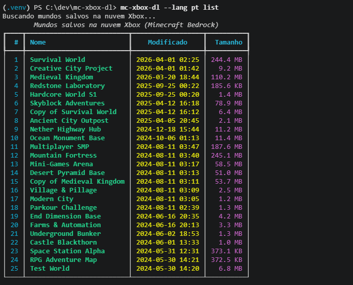
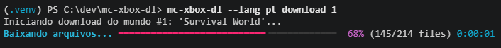

# mc-xbox-dl

[](https://github.com/vinifreitaspaulino/mc-xbox-dl/actions/workflows/ci.yml)
[](LICENSE)
[](https://www.python.org/downloads/)
[](#)

> **Leia isto em outro idioma:** [English](README.md)

Ferramenta de linha de comando (CLI) para listar, exportar e baixar mundos pessoais de **Minecraft Bedrock (Xbox)** salvos no armazenamento em nuvem da Xbox Live como pacotes `.mcworld` ou instalá-los diretamente na pasta local do jogo no PC.

> **NÃO É UM PRODUTO OFICIAL DO MINECRAFT. NÃO APROVADO OU ASSOCIADO À MOJANG OU MICROSOFT.**  
> O `mc-xbox-dl` é um utilitário independente, gratuito e de código aberto criado exclusivamente para backup pessoal e portabilidade de dados do próprio usuário sob suas credenciais. Não é afiliado, mantido nem endossado pela Microsoft Corporation ou Mojang Studios.




---

## Aviso Importante e Isenção de Riscos

- **APIs Não Documentadas e Emulação de Cliente:** Esta ferramenta comunica-se diretamente com os endpoints não documentados de Connected Storage e Title Storage da Xbox Live (`titlestorage.xboxlive.com`). Para autenticar, o programa utiliza o `client_id` público do **Minecraft Bedrock (Android)** (`0000000048183522`), assina requisições Proof-of-Possession com chave de dispositivo efêmera ECDSA P-256 e solicita tokens de autorização SISU/XSTS vinculados ao `TitleId` do console (`1828326430`).
- **Riscos Contratuais e de Conta:** O acesso a APIs não documentadas da Xbox Live utilizando identificadores de clientes oficiais não é homologado pela Microsoft ou Mojang. Existem riscos inerentes que incluem o **bloqueio ou alteração dos endpoints pela Microsoft**, limitação temporária de acesso (rate-limit) ou **sanções contratuais (incluindo suspensão ou banimento da conta Xbox Live / Microsoft)** por violação do Contrato de Serviços da Microsoft. O uso desta ferramenta ocorre estritamente por sua conta e risco.
- **Operação Somente Leitura e Proteção de Taxa:** Para mitigar riscos técnicos, o `mc-xbox-dl` opera estritamente em **modo somente leitura (`GET`)**, transfere exclusivamente os mundos pertencentes à própria conta autenticada, aplica espaçamento temporal entre downloads e interrompe imediatamente a execução (`fail-fast`) caso receba status HTTP `401`, `403` ou `429`.
- **Consentimento Explícito Necessário:** A execução do comando `mc-xbox-dl login` exige a aceitação interativa do aviso de risco ou a utilização da flag `--accept-risk` em scripts automatizados.
- **Privacidade Local:** Todas as credenciais e tokens são armazenados localmente na sua máquina (`%APPDATA%\mc-xbox-dl` no Windows ou `~/.config/mc-xbox-dl` no Linux). Nenhum dado é enviado a terceiros ou servidores de telemetria. Consulte o arquivo [SECURITY.md](SECURITY.md) para mais detalhes.

---

## Recursos Principais

- **100% Gratuito e Código Aberto:** Sem taxas de assinatura, sem servidores intermediários e sem necessidade de assinar o Minecraft Realms.
- **Autenticação Segura via Device Code:** Faça login pelo fluxo oficial de autorização de dispositivo da Microsoft (`https://www.microsoft.com/link`). Sua senha nunca é digitada nem armazenada na CLI.
- **Interface Bilíngue (i18n):** Detecção automática do idioma do sistema operacional (Português / Inglês) com alternância manual e salvamento automático da preferência (`--lang pt` / `--lang en`).
- **Listagem de Mundos com Cache:** Consulta rápida de nomes, datas de modificação e tamanhos com cache local inteligente de 5 minutos (`--no-cache` para forçar atualização em tempo real).
- **Download Individual e em Lote:** Baixe mundos específicos por índice, nome ou ID, ou exporte todos os mundos da nuvem (`--all`) com retomada automática e controle de taxa entre transferências.
- **Instalação Direta no PC (`--install`):** Detecta automaticamente instalações modernas **GDK** (`%APPDATA%\Minecraft Bedrock\Users\<ID>\...`) e legadas **UWP** (`%LOCALAPPDATA%\Packages\Microsoft.MinecraftUWP_...\...`) no Windows, extraindo os mundos diretamente na pasta `minecraftWorlds`.
- **Conversão Automática para Minecraft Java Edition (`--java`, `--install-java`):** Baixa e executa automaticamente o [Chunker CLI](https://github.com/HiveGamesOSS/Chunker) oficial (`HiveGamesOSS/Chunker`) para converter mundos do Xbox (Bedrock) para o formato Minecraft Java Edition e, opcionalmente, instalá-los diretamente em `.minecraft/saves` no Windows e no Linux.
- **Suporte Multiplataforma (Windows e Linux):** Exportação nativa de arquivos `.mcworld` tanto no Windows quanto no Linux, exibindo orientações claras sobre os diretórios de launchers Bedrock no Linux (`mcpelauncher`) quando `--install` é utilizado.
- **Validação de Integridade Estrutural:** Verifica os cabeçalhos NBT do Bedrock (`level.dat`), o título do mundo (`levelname.txt`) e os arquivos do banco LevelDB (`db/CURRENT`, `db/MANIFEST-*`) antes de concluir qualquer pacote ou instalação.
- **Proteções de Rede e Parada Imediata (Fail-Fast):** Pausa controlada entre downloads em lote, cabeçalhos HTTP neutros e interrupção imediata de segurança caso a API retorne status HTTP `401`, `403` ou `429`.

---

## Instalação

### 1. Pré-requisitos
- **Python 3.11 ou superior:** Baixe em [python.org](https://www.python.org/downloads/) ou instale pelo gerenciador de pacotes da sua distribuição Linux.
  > **Nota para Windows:** Na primeira tela do instalador do Python, marque a opção **"Add python.exe to PATH"** antes de clicar em *Install Now*.
- **Git** (opcional; você também pode baixar o repositório como arquivo `.zip`).
- **Java 17 ou superior** *(opcional — necessário apenas para quem utilizar `--java` ou `--install-java` na conversão para Minecraft Java Edition)*: Baixe o OpenJDK 17+ em [Adoptium Temurin](https://adoptium.net/) ou instale pelo gerenciador de pacotes do seu sistema.

### 2. Clonar e Configurar o Ambiente Virtual

#### No Windows (PowerShell):
```powershell
# Clonar o repositório
git clone https://github.com/vinifreitaspaulino/mc-xbox-dl.git
cd mc-xbox-dl

# Permitir a execução de scripts na sessão atual do PowerShell (caso bloqueado)
Set-ExecutionPolicy -Scope Process -ExecutionPolicy Bypass

# Criar e ativar o ambiente virtual (.venv)
python -m venv .venv
.\.venv\Scripts\Activate.ps1

# Instalar o pacote em modo editável
pip install -e .
```

#### No Linux (Bash / Zsh):
```bash
# Clonar o repositório
git clone https://github.com/vinifreitaspaulino/mc-xbox-dl.git
cd mc-xbox-dl

# Criar e ativar o ambiente virtual (.venv)
python3 -m venv .venv
source .venv/bin/activate

# Instalar o pacote em modo editável
pip install -e .
```

---

## Guia de Uso

### 1. Autenticar na Conta Microsoft (`login`)
```bash
# Login interativo (exibe aviso de risco e solicita confirmação)
mc-xbox-dl login

# Login não-interativo (para scripts ou automações)
mc-xbox-dl login --accept-risk
```
Siga as instruções exibidas no terminal:
1. Abra a URL indicada na tela (geralmente `https://www.microsoft.com/link`) no navegador do PC ou celular.
2. Digite o código alfanumérico de 8 caracteres exibido no terminal.
3. Entre com a conta Microsoft que possui seus mundos salvos no Xbox.

### 2. Verificar a Sessão Ativa (`whoami`)
```bash
mc-xbox-dl whoami
```

### 3. Listar os Mundos na Nuvem (`list`)
```bash
# Exibir tabela formatada com os mundos sincronizados na nuvem
mc-xbox-dl list

# Ignorar o cache local de 5 minutos e consultar a Xbox Live em tempo real
mc-xbox-dl list --no-cache
```

### 4. Baixar e Exportar Mundos (`download`)

#### Opção A: Baixar um Único Mundo como `.mcworld`
Você pode indicar o mundo pelo **número do índice (`#`)** exibido no comando `list`, pelo **nome exato do mundo** ou pelo **`world_id`**:
```bash
# Baixar o mundo #1 na pasta atual
mc-xbox-dl download 1

# Baixar o mundo #1 em uma pasta específica
mc-xbox-dl download 1 -o ./downloads

# Baixar pelo nome do mundo e sobrescrever caso o arquivo .mcworld já exista
mc-xbox-dl download "Meu Mundo Survival" -o ./downloads --force
```

#### Opção B: Baixar Todos os Mundos em Lote (`--all`)
```bash
# Baixar todos os mundos como arquivos .mcworld (pula automaticamente os que já existem)
mc-xbox-dl download --all -o ./meus_mundos

# Forçar o novo download sobrescrevendo arquivos .mcworld existentes
mc-xbox-dl download --all -o ./meus_mundos --force
```

#### Opção C: Instalar Diretamente no Minecraft Bedrock (`--install`, `--install-dir`)
No Windows, a flag `--install` extrai e valida a pasta do mundo diretamente dentro do diretório local `minecraftWorlds`, fazendo com que o mundo apareça imediatamente dentro do jogo:
```bash
# Detectar o Minecraft Bedrock no Windows e instalar o mundo #1 diretamente (sem gerar .mcworld)
mc-xbox-dl download 1 --install

# Instalar diretamente no Minecraft E TAMBÉM salvar uma cópia .mcworld de backup em ./backups
mc-xbox-dl download 1 --install -o ./backups

# Instalar TODOS os mundos da nuvem diretamente no Minecraft Bedrock do PC
mc-xbox-dl download --all --install

# Instalar em um diretório 'minecraftWorlds' informado manualmente (funciona em qualquer SO)
mc-xbox-dl download 1 --install-dir "C:\CaminhoCustomizado\games\com.mojang\minecraftWorlds"
```

**Como Funciona o `--install`:**
1. **Descoberta Primária (GDK Moderno no Windows):** Escaneia `%APPDATA%\Minecraft Bedrock\Users\<USER_ID>\games\com.mojang\minecraftWorlds` nas pastas numéricas de 64 bits dos usuários (ignorando a pasta `Shared`).
2. **Descoberta de Fallback (UWP Legado no Windows):** Verifica os pacotes Retail (`Microsoft.MinecraftUWP_8wekyb3d8bbwe`) e Beta/Preview (`Microsoft.MinecraftWindowsBeta_8wekyb3d8bbwe`) em `%LOCALAPPDATA%\Packages\`.
3. **Resolução de Múltiplos Perfis:** Caso existam múltiplas contas ou instalações no PC, o modo interativo exibe uma tabela para você escolher o perfil desejado; o modo não-interativo seleciona automaticamente o perfil modificado mais recentemente.
4. **Extração Atômica com Staging:** Os arquivos são montados em uma pasta temporária, validados (`level.dat`, `levelname.txt` e `db/`) e movidos atomicamente para `minecraftWorlds`.
5. **Comportamento no Linux:** No Linux, usar `--install` (sem `--install-dir`) gera normalmente o pacote `.mcworld` na pasta de saída e exibe um painel informativo com os caminhos padrão do `mcpelauncher` (`~/.var/app/io.mrarm.mcpelauncher/...` e `~/.local/share/mcpelauncher/...`).

#### Opção D: Converter para Minecraft Java Edition (`--java`, `--install-java`)
Utilizando o [Chunker CLI](https://github.com/HiveGamesOSS/Chunker) oficial, o `mc-xbox-dl` pode converter automaticamente os mundos Bedrock baixados para o formato do **Minecraft Java Edition** (requer **Java 17+** no `PATH`; o binário `chunker-cli.jar` é baixado e salvo em cache automaticamente na primeira execução):
```bash
# Converter o mundo #1 para uma pasta Java Edition no diretório atual (./<Nome do Mundo> (Java)/)
mc-xbox-dl download 1 --java

# Converter o mundo #1 especificando a versão alvo do Minecraft Java (padrão: 1.21.4)
mc-xbox-dl download 1 --java --java-version 1.20.6 -o ./mundos_java

# Converter e instalar o mundo #1 diretamente na pasta '.minecraft/saves' local (Windows e Linux)
mc-xbox-dl download 1 --install-java

# Instalar simultaneamente no Minecraft Bedrock E no Minecraft Java Edition
mc-xbox-dl download 1 --install --install-java

# Converter e instalar em uma pasta 'saves' customizada do Minecraft Java
mc-xbox-dl download 1 --java-saves-dir "D:\MultiMC\instances\1.21.4\.minecraft\saves"

# Instalar no Java Edition E TAMBÉM salvar uma cópia de backup do .mcworld Bedrock em ./backups
mc-xbox-dl download 1 --install-java -o ./backups
```

**Comportamento do `-o` / `--output` com `--java`:**
- **Apenas `--java` (sem instalação):** `-o` define onde a pasta do mundo Java será salva (ex.: `./saida/<Nome do Mundo> (Java)/`). O arquivo `.mcworld` não é gerado.
- **Com `--install-java`:** O mundo Java é colocado direto no `.minecraft/saves`. Se `-o` também for passado, ele salva uma cópia extra de backup em `.mcworld` nessa pasta. Se `-o` for omitido, nenhum arquivo residual é criado na pasta de trabalho.

### 5. Jogar no Minecraft
- **Se você exportou um arquivo `.mcworld`:** Dê um duplo clique no arquivo `.mcworld` pelo gerenciador de arquivos para importá-lo automaticamente no Minecraft Bedrock.
- **Se você usou `--install` no Windows:** Abra o Minecraft Bedrock (ou reinicie o jogo caso ele já estivesse aberto durante a instalação) e o mundo aparecerá imediatamente na sua lista de mundos.

### 6. Encerrar Sessão Local (`logout`)
Remove os tokens de sessão armazenados no computador:
```bash
mc-xbox-dl logout
```

### 7. Alterar o Idioma da Interface (`--lang`)
O `mc-xbox-dl` detecta automaticamente o idioma do seu sistema operacional na primeira execução (`pt` ou `en`). Ao passar `--lang`, o idioma é alterado e sua preferência fica salva para os próximos comandos:
```bash
mc-xbox-dl --lang pt list     # Altera para Português e salva a preferência
mc-xbox-dl --lang en list     # Altera para Inglês e salva a preferência
```

---

## Referência da CLI e Códigos de Saída

### Opções Globais
| Flag | Descrição |
| :--- | :--- |
| `--lang {en,pt,en-US,pt-BR}` | Define o idioma da interface e salva a preferência nas configurações locais |
| `--debug` | Grava dumps de diagnóstico HTTP redigidos (sem segredos) na pasta `debug/` |
| `--version` | Exibe a versão instalada do programa |
| `-h`, `--help` | Exibe a mensagem de ajuda do comando |

### Códigos de Saída (Exit Codes)
| Código | Significado |
| :--- | :--- |
| `0` | Sucesso |
| `1` | Erro inesperado, cancelamento pelo usuário ou falha parcial no lote |
| `2` | Argumentos inválidos ou arquivo de destino já existente (sem `--force`) |
| `3` | Não autenticado ou sessão expirada/inválida (execute `mc-xbox-dl login`) |
| `4` | Falha de conexão, timeout de rede ou limite de taxa (`429`) |
| `5` | Mundo não encontrado ou nenhum mundo sincronizado na nuvem |
| `6` | Falha na montagem, validação de integridade ou empacotamento do mundo |
| `7` | Acesso negado (`401` / `403`) pela Xbox Live |
| `8` | Limite de requisições (`429`) da Xbox Live atingido |
| `9` | Ambiente Java ausente/desatualizado, falha no download do Chunker CLI ou erro na conversão para Java (`ConversionError`) |

---

## Perguntas Frequentes (FAQ) e Resolução de Problemas

### Por que um mundo do meu Xbox não aparece no `mc-xbox-dl list`?
Apenas os mundos que foram **sincronizados na nuvem da Xbox Live** pelo console aparecem na listagem. Abra o Minecraft no seu Xbox conectado à internet, entre no mundo desejado e salve/saia para acionar a sincronização com a nuvem.

### Mundos do Minecraft Realms são suportados?
**Não.** O Minecraft Realms é um serviço pago de hospedagem com infraestrutura e APIs próprias. O `mc-xbox-dl` acessa exclusivamente os saves pessoais armazenados gratuitamente no Xbox Live Connected Storage.

### O que acontece se a Xbox Live limitar as requisições durante o `--all`?
Durante downloads em lote (`--all`), a ferramenta aplica um intervalo automático entre cada mundo para respeitar os limites do servidor. Se a Xbox Live retornar status HTTP `429` (Too Many Requests) ou `401`/`403`, o lote é interrompido imediatamente (`fail-fast`) para proteger sua conta. Aguarde alguns minutos e execute o comando novamente — os mundos já baixados serão ignorados automaticamente.

### Como gerar logs de diagnóstico (`--debug`)?
Adicione `--debug` a qualquer comando para salvar registros JSON redigidos (com todos os tokens, cabeçalhos sensíveis e segredos ocultados) em `%APPDATA%\mc-xbox-dl\debug\` (Windows) ou `~/.config/mc-xbox-dl/debug\` (Linux):
```bash
mc-xbox-dl --debug list
```

---

## Desenvolvimento e Testes

```bash
# Instalar dependências de desenvolvimento (pytest, respx, ruff)
pip install -e ".[dev]"

# Executar a suíte completa de testes
pytest

# Verificar lint e formatação do código
ruff check .
ruff format --check .
```

---

## Links da Documentação
- [English (README.md)](README.md)
- [Histórico de Alterações (CHANGELOG.md)](CHANGELOG.md)
- [Política de Segurança (SECURITY.md)](SECURITY.md)
- [Arquitetura e Decisões Técnicas (docs/DECISIONS.md)](docs/DECISIONS.md)
- [Pesquisa de Protocolo e Endpoints (docs/RESEARCH.md)](docs/RESEARCH.md)
- [Especificação do Protocolo Connected Storage (docs/PROTOCOL.md)](docs/PROTOCOL.md)

---

## Licença
Distribuído sob a licença MIT. Consulte o arquivo [LICENSE](LICENSE) para mais detalhes.
